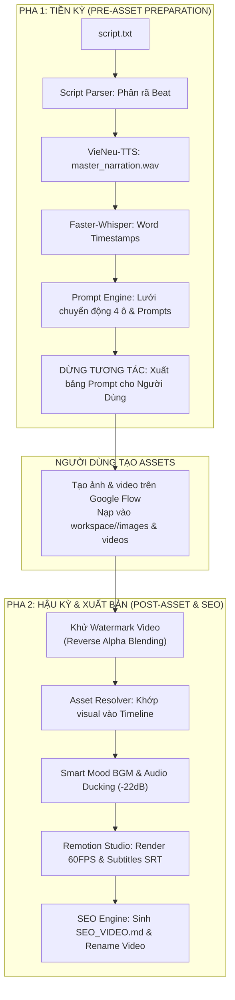

# Video Production Pipeline: End-to-End Master Skill

Kỹ năng này chịu trách nhiệm điều phối toàn bộ quy trình sản xuất video từ kịch bản thô cho đến sản phẩm hoàn chỉnh sẵn sàng tải lên YouTube, tuân thủ nghiêm ngặt triết lý **Master Voice & Whisper Timeline** và mỹ thuật **60FPS Cinematic / Simple Ways of Life**.

---

## 1. Khi Nào Kích Hoạt Kỹ Năng Này?

Kích hoạt skill này khi:
* Người dùng cung cấp kịch bản (`script.txt`) và yêu cầu sản xuất video mới.
* Cần chạy toàn bộ pipeline âm thanh, hình ảnh, hậu kỳ và SEO cho một dự án trong `workspace/<channel>/<project>/`.
* Cần kiểm tra, khử watermark video hoặc render lại phiên bản hoàn chỉnh 60FPS kèm phụ đề SRT.
* Cần tạo bộ tài liệu SEO Video xuất bản (Video Title < 60 ký tự, Description có Timestamps chính xác từng giây, Tags, Pinned Comment).

---

## 2. Quy Chuẩn Video Dài & Mật Độ Tri Thức (Longform Video Architecture)

Kênh theo đuổi định dạng **Video Dài Chuyên Sâu (Longform Documentary / Essay)** với các quy chuẩn bắt buộc:
* **Thời lượng mục tiêu**: **> 15 phút, trung bình ~20 phút, tối đa 30–35 phút** tùy thuộc vào chủ đề.
* **Nguyên tắc "Sâu sắc, Tinh gọn, Không Lan Man"**: Video dài vì hàm lượng khoa học và thực chiến cao, tuyệt đối không chèn từ ngữ thừa thãi hay câu giờ để đạt số phút. Mọi phân tích phải đi thẳng vào cơ chế thần kinh học (Dopamine, Prefrontal Cortex), mô hình hành vi và quy trình thực hiện.
* **Quy mô kịch bản**:
  - Video ~20 phút: ~3.000 – 3.500 từ tiếng Việt (tốc độ đọc VieNeu-TTS ~150-160 từ/phút).
  - Video ~30 phút: ~4.500 – 5.000 từ tiếng Việt.
  - Phân rã từ 50 – 75 visual beats (thời lượng hiển thị mỗi beat 10–20s kết hợp Ken Burns camera physics, infographic Satori/GSAP và hoạt họa doodle `@stickman`).

* **Quy chuẩn Cấu trúc Mở Đầu & Cầu Nối Định Danh (Post-Hook Transition Bridge)**:
  - 15–30s đầu: 3 tầng Hook (Nỗi đau $\to$ Câu hỏi phản tư duy $\to$ Cam kết khoa học).
  - **Bắt buộc**: Ngay sau Hook phải chèn 1 câu cầu nối định danh kênh để chuyển tiếp mượt mà vào nội dung chính (ví dụ: *"Hôm nay, hãy cùng {channel_name} tìm hiểu..."*, *"Xin chào, tôi là {character_name} từ {channel_name}..."*).
  - Outro kết thúc: Độc lập, chỉ chứa lời khuyên đọng lại và câu Slogan kết video, không lặp lại câu chào mừng.

---

## 3. Quy Trình Vận Hành 2 Pha Tương Tác (Interactive 2-Phase Cycle)

Để tối ưu hóa sự phối hợp nhịp nhàng giữa trí tuệ nhân tạo và người dùng (khâu sinh ảnh/video 0 credit trên Google Flow), quy trình được tổ chức thành 2 Pha liền mạch trong cùng một phiên làm việc:



---

### PHA 1: TIỀN KỲ & SINH PROMPTS (PRE-ASSET)

> [!CAUTION]
> **NGUYÊN TẮC CỐT LÕI (VOICE-FIRST)**: Bắt buộc hoàn tất Bước 3 (VieNeu-TTS) và Bước 4 (Faster-Whisper) TRƯỚC KHI chuyển sang Bước 5 (Sinh prompts). Mọi visual B-roll và thời lượng slot video AI bắt buộc phải căn cứ theo dòng thời gian thực tế của Master Audio. Tuyệt đối cấm đảo thứ tự hoặc tạo visual trước.

1. **Khởi tạo project**:
   ```bash
   python run_pipeline.py init -p <project_name> -c <channel_id>
   ```
2. **Phân rã kịch bản**:
   ```bash
   python run_pipeline.py parse -p <project_name>
   ```
3. **Sinh Master Audio thoại 1 lần duy nhất**:
   * Sử dụng VieNeu-TTS v3 Turbo (giọng `Hải Đăng` hoặc `Thiện Minh`), xuất `master_narration.wav`.
   ```bash
   python run_pipeline.py voice -p <project_name>
   ```
4. **Bóc tách Timeline mili-giây bằng Faster-Whisper**:
   ```bash
   python run_pipeline.py transcribe -p <project_name>
   ```
5. **Sinh danh sách Prompt ảnh & Lưới chuyển động 4 ô (Storyboard Motion Grid)**:
   ```bash
   python run_pipeline.py prompts -p <project_name>
   ```
   * Xuất danh sách tại `workspace/<project>/prompts/prompts_img_list.txt` và `prompt_aiv_list.txt`.
6. **Điểm Dừng Tương Tác**: Agent xuất bảng tổng hợp Prompt, thông báo và chờ người dùng tạo ảnh/video trên Google Flow.

---

### PHA 2: HẬU KỲ 60FPS & BỘ SEO XUẤT BẢN (POST-ASSET & SEO)

Sau khi người dùng đã nạp ảnh và video vào thư mục `images/` và `videos/`, Agent tự động thực hiện:

1. **Khử Watermark Video (Tự động 100%)**:
   * Ứng dụng công nghệ **Reverse Alpha Blending + Contour Laplace Diffusion** để xóa sạch ngôi sao watermark của Google Veo/Omni Flash mà giữ nguyên 100% tỷ lệ khung hình (Zero Zoom, Zero Crop):
   ```bash
   python run_pipeline.py clean -p <project_name>
   ```
2. **Khớp nối tài nguyên (Asset Matching)**:
   ```bash
   python run_pipeline.py match -p <project_name>
   ```
3. **Phối nhạc nền thông minh (Smart Mood BGM & Audio Ducking)**:
   * Tự động crossfade giữa 2 track (Part 1 u tối/suy tư $\to$ Part 2 bừng sáng/thức tỉnh) và giảm âm lượng xuống `-22dB` khi nhân vật nói:
   ```bash
   python run_pipeline.py bgm -p <project_name>
   ```
4. **Render Video Remotion 60FPS & Xuất Phụ Đề SRT**:
   ```bash
   python run_pipeline.py render -p <project_name>
   ```
   * Video xuất ra tại: `workspace/<project>/out/final_60fps.mp4`
   * Phụ đề rời chuẩn tại: `workspace/<project>/out/subtitles_vi.srt`
5. **Đóng gói Video SEO Kit Hoàn Chỉnh**:
   * Chạy script tự động trích xuất Timestamps chính xác từ Whisper và đóng gói file SEO:
   ```bash
   python .agent/skills/video-pipeline-end-to-end/scripts/generate_video_seo.py -p workspace/<channel>/<project> -c channels/<channel>
   ```
   * Sản phẩm đầu ra tại `workspace/<project>/out/SEO_VIDEO.md` bao gồm:
     - 3 Tiêu đề High-CTR (< 60 ký tự) chuẩn SEO.
     - Mô tả video 300 từ tối ưu từ khóa trong 2 dòng đầu.
     - Danh sách Phân cảnh / Timestamps (bắt đầu bằng `00:00`) chuẩn Key Moments của Google Search.
     - Thẻ Tags (1 dòng copy dán).
     - Bình luận ghim (Pinned comment) kích thích tương tác.
     - File video upload đã được tự động sao lưu và đổi tên chuẩn SEO dạng `<seo-slug>.mp4`.
