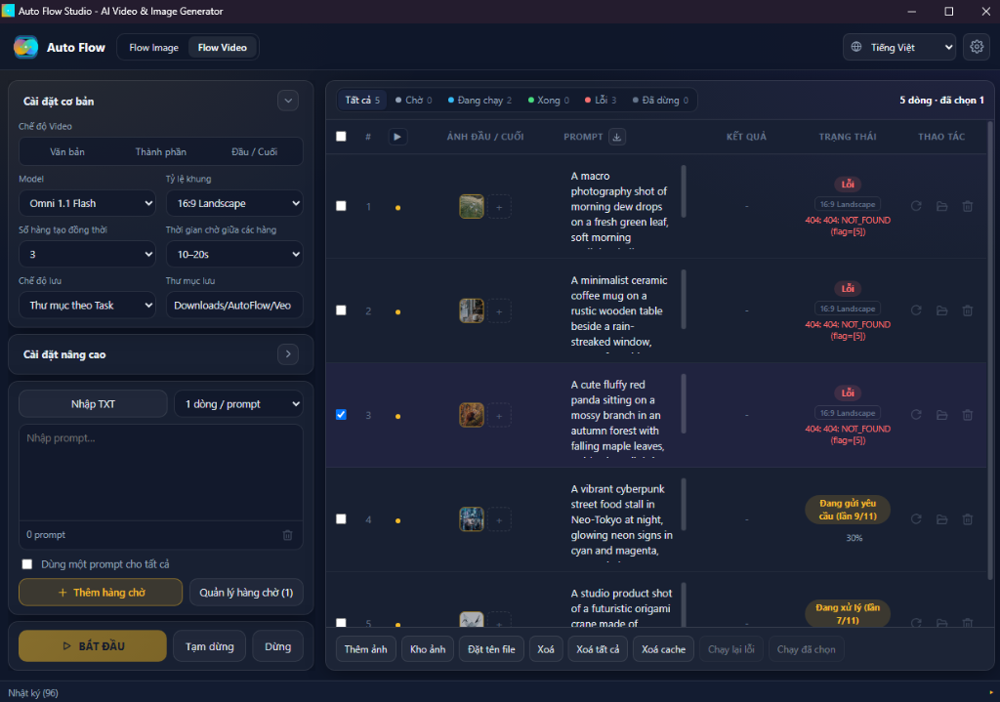
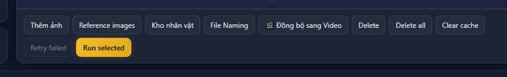
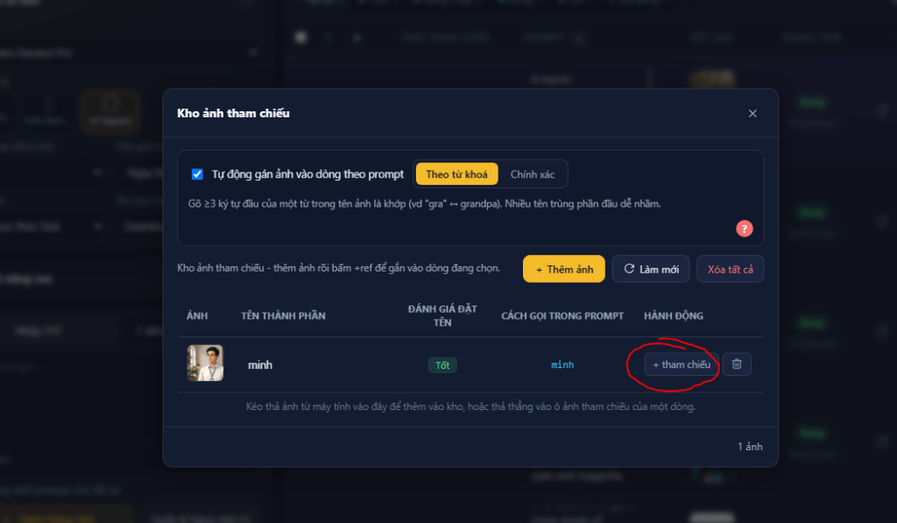
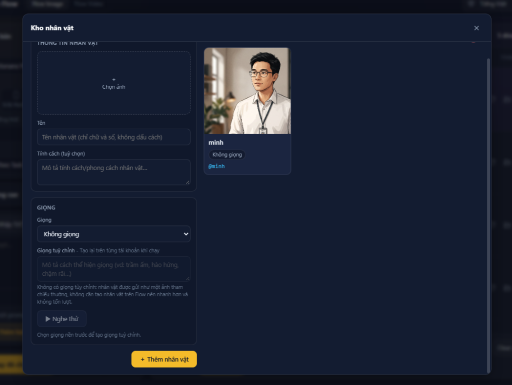
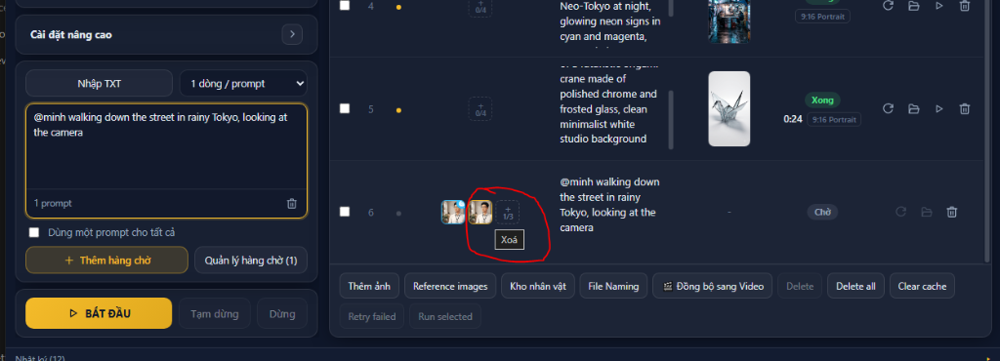

# Auto Flow Studio: AI Video & Image Generator

<p align="center">
  
</p>

<p align="center">
  <b>Công cụ tự động hoá hàng loạt & điều phối sáng tạo AI chuyên nghiệp cho Google Flow (flow.google.com)</b><br />
  <i>Tích hợp sâu giao thức native RPC batchexecute, hỗ trợ Veo 3.1, Omni Flash, Quản lý Nhân vật nhất quán & Tự động hoá quy trình làm phim AI.</i>
</p>

<p align="center">
  
  
  
  
  
</p>

---

## 🖥️ Tổng quan Giao diện (Interface Overview)



**Auto Flow Studio** là Chrome Extension (Manifest V3) chuyên dụng dành cho Google Chrome và Microsoft Edge. Tiện ích cung cấp giao diện Control Panel độc lập, hiện đại với Dark Theme tối ưu cho nhà sáng tạo nội dung, cho phép quản lý kịch bản, tự động hoá hàng loạt prompt ảnh và video AI chất lượng cao trực tiếp trên **Google Flow (`flow.google.com`)**.

---

## ⚡ 1. Sự khác biệt: RPC Native vs Tiện ích giả lập DOM cũ

Trước đây, nhiều công cụ tự động thường dùng phương pháp **giả lập chuột và bàn phím (DOM Simulation / Clicker)**. Phương pháp này rất chậm, dễ bị Google chặn honeypot hoặc hỏng hoàn toàn mỗi khi Google thay đổi cấu trúc mã nguồn web.

Auto Flow Studio được xây dựng trên **kiến trúc Native RPC `batchexecute`**:

| Tiêu chuẩn kỹ thuật | Tool cũ (DOM Clicker / Simulation) | Auto Flow Studio (RPC Native) |
|---|---|---|
| **Phương thức thực thi** | Giả lập click chuột, gõ phím vào khung input web | Giao tiếp trực tiếp qua Google RPC Channel ngầm |
| **Độ ổn định** | Dễ vỡ giao diện, xung đột popup, trượt focus | Bền vững tuyệt đối, độc lập với thay đổi giao diện DOM |
| **Tốc độ điều phối** | Chậm (phải đợi render giao diện, trễ UI) | Tức thì (gửi và nhận payload trong mili-giây) |
| **Khả năng chạy ngầm** | Phải mở màn hình để quan sát chuột click | Chạy độc lập trong nền, tab ẩn vẫn render mượt mà |
| **Quản lý dữ liệu** | Phụ thuộc vào cookie và session DOM | Đồng bộ tự động project ID, session token và media blobs |

---

## 🎛️ 2. Thanh công cụ & Chức năng Điều phối (Toolbar & Controls)



Thanh công cụ được tinh gọn với đầy đủ các tác vụ hàng loạt:

- **▷ Bắt đầu (Run All)**: Kích hoạt render toàn bộ các dòng hợp lệ chưa hoàn thành trong bảng.
- **▷ Chạy đã chọn (Selective Run)**: Chọn từng dòng cụ thể thông qua checkbox để render hoặc render lại (retry) chỉ những dòng mong muốn.
- **🔄 Đồng bộ ảnh qua Video (Sync Images to Video)**: Chuyển toàn bộ ảnh vừa tạo thành công từ Tab Hình Ảnh sang Tab Video trong cùng một Task, tự động điền prompt và gán ảnh tham chiếu giúp tiết kiệm thời gian làm phim liên tục.
- **🗑️ Xoá trạng thái**: Làm mới trạng thái của các dòng để sẵn sàng cho chu kỳ sinh mới.
- **⚙️ Cấu hình Model & Tỉ lệ khung hình**: Dễ dàng lựa chọn mô hình sinh video (`Veo 3.1`, `Veo 3.1 Lite`, `Omni Flash`...) cùng tỉ lệ `16:9` (Ngang) hoặc `9:16` (Dọc/Shorts/TikTok).

---

## 🖼️ 3. Kho Ảnh Tham Chiếu (Reference Image Library)



Kho ảnh tham chiếu giúp bạn quản lý các tài nguyên hình ảnh cố định (phong cách, bối cảnh, đạo cụ, màu sắc) để tái sử dụng xuyên suốt kịch bản.

### Các tính năng cốt lõi:
1. **Quản lý trực quan**: Tải lên nhiều ảnh tham chiếu, đặt tên gợi nhớ cho từng ảnh.
2. **Nút `+ tham chiếu`**: Nhấp một chạm để gán ngay ảnh đang chọn vào các dòng được đánh dấu trong bảng kịch bản (kèm thông báo trạng thái tức thì).
3. **Tự động gán ảnh vào dòng theo Prompt**:
   - Khi bật tuỳ chọn này, hệ thống sẽ tự động quét từ khoá trong nội dung prompt.
   - Nếu phát hiện tên của ảnh tham chiếu trong prompt, tiện ích sẽ tự động đưa ảnh đó vào danh sách tham chiếu của dòng tương ứng mà không cần gán thủ công!

---

## 👤 4. Kho Nhân Vật & Nhất Quán Khuôn Mặt (Character Library)



Đảm bảo nhân vật của bạn xuất hiện đồng nhất qua mọi khung hình và phân cảnh video.

### Cách thức hoạt động:
- **Tạo hồ sơ nhân vật**: Thêm ảnh đại diện chân dung, đặt tên định danh cho nhân vật (ví dụ: `minh`, `alex`, `lisa`).
- **Chọn chế độ giọng / Không giọng**:
  > [!TIP]
  > Nên chọn tuỳ chọn **"Không giọng"** khi tạo nhân vật. Chế độ này tập trung đồng bộ đặc trưng khuôn mặt (Face Consistency) thuần tuý qua mô hình Veo 3.1, giúp video ổn định và hạn chế tối đa lỗi kết nối audio RPC bên thứ ba.

### Cú pháp gọi nhân vật `@tên_nhân_vật` trong Bảng Prompt:



Khi viết prompt, bạn chỉ cần gõ cú pháp:
```text
@minh đang đi dạo trên đường phố Tokyo về đêm dưới trời mưa ánh đèn neon rực rỡ
```
- Hệ thống sẽ tự động nhận diện cú pháp `@minh` và hiển thị **Huy hiệu nhân vật** kèm ảnh đại diện thu nhỏ ngay trên dòng đó.
- Dữ liệu tham chiếu nhân vật sẽ được nạp trực tiếp vào payload gửi lên Google Flow để giữ trọn vẹn đặc điểm ngoại hình của nhân vật.

---

## 📝 5. Quy Ước Đặt Tên File Tự Động (File Naming Conventions)

Hệ thống cho phép cấu hình mẫu tên file xuất ra để tự động lưu trữ khoa học, không bị trùng lặp:

### Cú pháp mẫu phổ biến:
```text
{index}_{model}_{aspect_ratio}_{prompt_clean}_{timestamp}
```

### Danh sách các biến Wildcard hỗ trợ:
| Biến Wildcard | Diễn giải | Ví dụ thực tế |
|---|---|---|
| `{index}` | Số thứ tự dòng trong bảng | `001`, `002` |
| `{prompt}` | Nội dung câu prompt | `co gai ngoi uong cafe` |
| `{model}` | Tên mô hình AI sử dụng | `veo_3_1_i2v`, `omni_flash` |
| `{aspect_ratio}` | Tỉ lệ khung hình | `16x9`, `9x16` |
| `{task_id}` | Mã định danh của Task hiện tại | `task_8f92a1` |
| `{date}` / `{timestamp}` | Thời gian xuất file | `2026-10-31`, `1730389200` |

---

## 🚀 6. Hướng Dẫn Cài Đặt & Khởi Chạy (Installation)

### Bước 1: Tải tiện ích vào Chrome / Edge
1. Mở trình duyệt và truy cập: `chrome://extensions/`
2. Bật công tắc **Chế độ dành cho nhà phát triển (Developer mode)** ở góc trên bên phải.
3. Nhấp vào nút **Tải tiện ích đã giải nén (Load unpacked)**.
4. Chọn thư mục: `google-flow-extension`.

### Bước 2: Kích hoạt kết nối với Google Flow
1. Mở một tab mới và truy cập: [https://flow.google.com](https://flow.google.com).
2. Đăng nhập tài khoản Google có quyền truy cập Google Flow.
3. Nhấp vào biểu tượng **Auto Flow Studio** trên thanh công cụ tiện ích của Chrome để mở bảng điều khiển.

> [!IMPORTANT]
> Mỗi khi cập nhật mã nguồn extension, hãy nhớ:
> 1. Vào `chrome://extensions` bấm nút **Tải lại (↻)** tại tiện ích Auto Flow Studio.
> 2. Sang tab `flow.google.com` và bấm **F5 (Làm mới trang)** để trình duyệt nạp lại adapter RPC mới nhất vào bộ nhớ.

---

## 💡 Mẹo Tối Ưu Khi Sử Dụng (Pro Tips)

- **Số lượng ảnh tham chiếu tối ưu**:
  - Đối với chế độ **Scene (I2V)**: Sử dụng 1 ảnh bắt đầu (First Frame) hoặc 1 ảnh kết thúc (Last Frame).
  - Đối với chế độ **Ingredients**: Có thể sử dụng tối đa 3 ảnh tham chiếu để mô hình Veo kết hợp phong cách và chất liệu.
- **Render từng phần**: Thay vì chạy toàn bộ hàng trăm prompt, bạn nên tích chọn từ 1 đến 3 dòng đại diện để kiểm tra trước phong cách hiển thị bằng nút **▷ Chạy đã chọn**, sau đó mới chạy hàng loạt.

---

<p align="center">
  Phát triển với ❤️ cho cộng đồng sáng tạo AI Video & Google Flow.
</p>
