# LỊCH NỘI DUNG 7 VIDEO ĐẦU TIÊN (EDITORIAL CALENDAR)
## Kênh: Thói Quen Thịnh Vượng (@thoi-quen-thinh-vuong)

> **Chiến lược tổng thể**: Hành trình Chuyển Hóa Khép Kín (Closed Transformation Journey) kết nối 7 video thành một chuỗi liên hoàn, tạo vòng lặp xem liên tục (Binge-watching Loop) cực mạnh.
> **Lịch phát sóng**: **3 video / tuần (Tối Thứ Hai, Thứ Tư, Thứ Bảy lúc 20:00)**, bắt đầu từ Thứ Hai, **02/11/2026**.
> **Tiêu chuẩn thời lượng & Mật độ tri thức**: Video dài chuyên sâu (> 15 phút, trung bình ~20 phút, tối đa 30-35 phút khi đào sâu chủ đề). Mọi kịch bản tuân thủ nguyên tắc *"Sâu sắc, Tinh gọn, Không Lan Man"* — dài vì chiều sâu khoa học và thực chiến, không chèn từ thừa câu giờ.

---

## BẢNG TỔNG QUAN LỊCH PHÁT SÓNG 7 VIDEO

| # | Mã Dự Án | Ngày Chiếu (20:00) | Thời Lượng | Trụ Cột Nội Dung | Tiêu Đề Chuẩn SEO (<60 ký tự) | Thumbnail Text | Trang Phục Stickman |
| :-: | :--- | :--- | :-: | :--- | :--- | :--- | :--- |
| **01** | `video_01` | **Thứ Hai 02/11** | ~20 phút *(Masterclass)* | Quản lý Dòng tiền | **Đừng Cố Tiết Kiệm Tiền Nữa! Hãy Làm 5 Điều Này Để Tự Động Giàu** | `ĐỪNG CỐ TIẾT KIỆM`<br/>5 Bước Tự Động Giàu | Outfit #3 (Blazer) & #4 (Áo sơ mi) |
| **02** | `video_02_dopamine` | **Thứ Tư 04/11** | ~20 phút | Khoa học Thần kinh | **Tại Sao Não Bộ Luôn Muốn Bạn Tiêu Tiền? (Cách Dừng Bốc Đồng)** | `BẪY NÃO BỘ`<br/>Tại Sao Hay Tiêu Tiền? | Outfit #1 (Trench coat) & #3 (Blazer) |
| **03** | `video_03_two_box` | **Thứ Bảy 07/11** | ~20 phút | Quản lý Dòng tiền | **Quy Tắc 2 Chiếc Hộp: Tiêu Xài Thoải Mái Mà Vẫn Tự Động Giàu** | `QUY TẮC 2 HỘP`<br/>Tiêu Tiền 0 Tội Lỗi | Outfit #6 (T-shirt tối giản) & #9 (Sweater) |
| **04** | `video_04_detox` | **Thứ Hai 09/11** | ~25 phút | Khoa học Thần kinh | **7 Ngày Dopamine Detox: Tái Cấu Trúc Não Bộ & Lấy Lại Tập Trung** | `DOPAMINE DETOX`<br/>7 Ngày Reset Não Bộ | Outfit #8 (Sport gym) & #7 (Cardigan) |
| **05** | `video_05_environment` | **Thứ Tư 11/11** | ~20 phút | Cuộc sống Autopilot | **Thiết Kế Môi Trường "Không Thể Lười": Tự Động Kỷ Luật Mỗi Ngày** | `MÔI TRƯỜNG AUTOPILOT`<br/>Kỷ Luật Không Cần Cố | Outfit #3 (Blazer) & #5 (Áo gió dã ngoại) |
| **06** | `video_06_identity` | **Thứ Bảy 14/11** | ~22 phút | Tâm lý học Hành vi | **Identity Shift: Thay Đổi Căn Tính Để Tự Động Kiên Trì Trọn Đời** | `THAY ĐỔI CĂN TÍNH`<br/>Kỷ Luật Trọn Đời | Outfit #1 (Trench coat) & #2 (Vest đen) |
| **07** | `video_07_master_flow` | **Thứ Hai 16/11** | ~28 phút *(Master)* | Cuộc sống Autopilot | **Bản Thiết Kế Dòng Tiền Tự Động: Tự Do Tài Chính Từ Con Số 0** | `DÒNG TIỀN TỰ ĐỘNG`<br/>Bản Thiết Kế Toàn Diện | Outfit #2 (Vest đen) & #5 (Áo gió dã ngoại) |

---

## CHI TIẾT THÔNG SỐ TỪNG VIDEO TRONG CHUỖI

---

### VIDEO 01 (Mở Màn - Masterclass Tài Chính Đỉnh Cao)
* **Mã thư mục dự án**: `workspace/thoi-quen-thinh-vuong/video_01/`
* **Thời gian công chiếu**: **20:00 — Thứ Hai, 02/11/2026**
* **Trụ cột nội dung**: Trụ cột 1 — Thói Quen Quản Lý Dòng Tiền (Financial Micro-Habits)
* **Playlist chỉ định**: `Thói Quen Quản Lý Dòng Tiền | Xây Dựng Hệ Thống Tài Chính Cá Nhân`
* **Thời lượng mục tiêu**: ~18 – 22 phút (Độ dài kịch bản ~3.200 – 3.500 từ, 65 visual beats, phân tích sâu cơ chế thần kinh học của sự khan hiếm và 5 hệ thống tự động hóa).
* **Tiêu đề chính thức**: `Đừng Cố Tiết Kiệm Tiền Nữa! Hãy Làm 5 Điều Này Để Tự Động Giàu`
* **Công thức Viral Hook 3 tầng (15s)**:
  1. *Nỗi đau*: Mỗi lần mở tài khoản cuối tháng là một lần thắt lòng, tự dằn vặt mình sao không thể tiết kiệm được đồng nào.
  2. *Câu hỏi phản tư duy*: Tại sao càng cố thắt lưng buộc bụng, bạn lại càng dễ rơi vào những đợt mua sắm bốc đồng vượt tầm kiểm soát?
  3. *Cam kết khoa học*: Vấn đề không nằm ở ý chí. Hãy thay thế ý chí bằng một hệ thống dòng tiền tự động 5 bước đơn giản.
* **Cấu trúc nội dung**:
  1. Nghịch lý của sự tiết kiệm kham khổ (Scarcity Trap).
  2. Bước 1: Tự trả cho bản thân trước (Pay yourself first).
  3. Bước 2: Tạo ma sát vật lý 48 giờ trước mỗi quyết định mua ngoài danh mục.
  4. Bước 3: Xác định con số vận hành tối thiểu (Baseline Living Number).
  5. Bước 4: Quy tắc 2 Chiếc Hộp (Tách biệt quỹ tự do và quỹ vô hình).
  6. Bước 5: Bật chế độ Autopilot cho tài khoản ngân hàng.
* **Concept Visual & Trang phục `@stickman`**: Outfit #3 (`modern dark blazer`) kết hợp Outfit #4 (`overworked wrinkled white dress shirt with loosened tie`).
* **Concept Thumbnail**:
  - Nền giấy trắng sạch `#FFFFFF` + Dotted grid. Stickman Outfit #3 chỉ tay vào bảng so sánh "TIẾT KIỆM KHAM KHỔ ❌ vs HỆ THỐNG TỰ ĐỘNG ✅".
  - Hộp highlight vàng dạ quang: `ĐỪNG CỐ TIẾT KIỆM`
  - Text phụ: `5 BƯỚC TỰ ĐỘNG GIÀU`
* **Điều hướng vòng lặp (Binge-watching Loop)**:
  - Ghim bình luận & Thẻ màn hình kết thúc (End Screen) trỏ thẳng sang **Video 02**: *"Nhưng tại sao dù biết phải tiết kiệm, não bộ chúng ta vẫn luôn thôi thúc tiêu tiền? Hãy xem Video 02 giải mã bẫy Dopamine..."*

---

### VIDEO 02 (Giải Mã Thần Kinh Học Về Tiền Bạc)
* **Mã thư mục dự án**: `workspace/thoi-quen-thinh-vuong/video_02_dopamine/`
* **Thời gian công chiếu**: **20:00 — Thứ Tư, 04/11/2026**
* **Trụ cột nội dung**: Trụ cột 2 — Tâm Lý Học Hành Vi & Khoa Học Thần Kinh (Behavioral Neuroscience)
* **Playlist chỉ định**: `Tâm Lý Học Tiền Bạc & Não Bộ | Cai Nghiện Dopamine & Kỷ Luật`
* **Thời lượng mục tiêu**: ~18 – 22 phút (Độ dài kịch bản ~3.200 từ, 60 visual beats).
* **Tiêu đề chính thức**: `Tại Sao Não Bộ Luôn Muốn Bạn Tiêu Tiền? (Cách Dừng Bốc Đồng)`
* **Công thức Viral Hook 3 tầng (20s)**:
  1. *Nỗi đau*: Bạn vừa trải qua một ngày làm việc kiệt sức, ngồi xuống sofa, lướt điện thoại và chỉ 20 phút sau bạn đã vô thức bấm thanh toán đơn hàng vài trăm nghìn đến tiền triệu mà không hề có kế hoạch trước.
  2. *Câu hỏi phản tư duy*: Tại sao cảm giác sung sướng tột độ không phải là lúc bạn nhận và sử dụng món đồ, mà lại chính là khoảnh khắc bạn bấm nút "Đặt Hàng"?
  3. *Cam kết khoa học*: Dopamine không phải là hormone của sự hưởng thụ, mà là hormone của sự săn tìm và kỳ vọng. Khi bạn hiểu được chiếc bẫy sinh học này của hạch nền (Basal Ganglia), bạn sẽ làm chủ hoàn toàn hành vi tài chính của mình.
* **Cấu trúc nội dung chuyên sâu (20 phút)**:
  1. *Giải phẫu sinh học*: Khám phá thí nghiệm của Wolfram Schultz về tế bào Dopamine và cơ chế "Dự đoán phần thưởng" (Reward Prediction Error).
  2. *Hội chứng Hối hận sau mua sắm (Post-Purchase Remorse)*: Tại sao nồng độ Dopamine tụt dốc thê thảm ngay sau khi giao dịch thành công.
  3. *Môi trường săn mồi kỹ thuật số*: Cách các sàn thương mại điện tử thiết kế thuật toán giật Dopamine (Flash sale, đếm ngược, giao diện đỏ/cam).
  4. *Giao thức 4 bước dừng chi tiêu bốc đồng*:
     - Kỹ thuật "Lướt sóng cảm xúc" (Urge Surfing) trong 90 giây đầu.
     - Thiết lập ma sát 3 tầng (Xóa thông tin thẻ lưu sẵn, vô hiệu hóa one-click buy).
     - Giao thức Dopamine thay thế (Dopamine Substitution Protocol): Đổi kích thích tốn tiền sang kích thích 0 đồng (uống nước đá, đi bộ nhanh).
     - Quy tắc 72 giờ ghi chép mong muốn.
  5. *Hành động vi mô*: Tải danh sách kiểm tra chi tiêu 72h và áp dụng ngay cho món đồ bạn đang muốn mua.
* **Concept Visual & Trang phục `@stickman`**: Outfit #1 (`dark tailored trench coat and burgundy turtleneck` - chiêm nghiệm) chuyển sang Outfit #3 (`modern dark blazer` - phân tích sơ đồ não bộ).
* **Concept Thumbnail**:
  - Stickman Outfit #1 đứng trầm tư nhìn vào sơ đồ bộ não 3D phát sáng vùng Dopamine, tay cầm chiếc ví đang tỏa ra những tia sáng vàng cám dỗ.
  - Hộp highlight đỏ cam: `BẪY NÃO BỘ`
  - Text phụ: `TẠI SAO HAY TIÊU TIỀN?`
* **Điều hướng vòng lặp (Binge-watching Loop)**:
  - Ghim bình luận trỏ sang **Video 03**: *"Sau khi đã kiểm soát được những cơn bốc đồng, làm sao để bạn có thể tiêu tiền một cách tự do, thoải mái mà không thấy tội lỗi? Hãy xem Video 03: Quy tắc 2 Chiếc Hộp..."*

---

### VIDEO 03 (Công Cụ Quản Lý Dòng Tiền Thực Chiến)
* **Mã thư mục dự án**: `workspace/thoi-quen-thinh-vuong/video_03_two_box/`
* **Thời gian công chiếu**: **20:00 — Thứ Bảy, 07/11/2026**
* **Trụ cột nội dung**: Trụ cột 1 — Thói Quen Quản Lý Dòng Tiền (Financial Micro-Habits)
* **Playlist chỉ định**: `Thói Quen Quản Lý Dòng Tiền | Xây Dựng Hệ Thống Tài Chính Cá Nhân`
* **Thời lượng mục tiêu**: ~18 – 22 phút (Kịch bản ~3.100 từ, 55 visual beats).
* **Tiêu đề chính thức**: `Quy Tắc 2 Chiếc Hộp: Tiêu Xài Thoải Mái Mà Vẫn Tự Động Giàu`
* **Công thức Viral Hook 3 tầng (20s)**:
  1. *Nỗi đau*: Bạn tự thưởng cho mình một bữa ăn ngon hoặc một món đồ yêu thích, nhưng suốt bữa ăn đó bạn không hề thấy ngon miệng vì trong lòng luôn có tiếng nói dằn vặt: "Đáng lẽ mình phải tiết kiệm khoản này".
  2. *Câu hỏi phản tư duy*: Nếu việc quản lý tiền bạc chỉ biến cuộc sống của bạn thành những chuỗi ngày kìm nén và khổ sở, liệu bạn có thể duy trì được nó suốt 10 năm?
  3. *Cam kết khoa học*: Bản chất con người chống lại sự trừng phạt. Phương pháp "Quy tắc 2 Chiếc Hộp" (The Two-Box System) tách bạch rạch ròi giữa bổn phận tương lai và tự do hiện tại, giúp bạn tiêu sạch đến đồng xu cuối cùng trong hộp chi tiêu mà tài sản vẫn nhân đôi.
* **Cấu trúc nội dung chuyên sâu (20 phút)**:
  1. *Hội chứng "Financial Guilt"*: Tại sao sự dằn vặt tài chính kích hoạt phản ứng căng thẳng (Cortisol) và dẫn đến hiện tượng "tiêu tiền trả đũa" (Revenge Spending).
  2. *Giải mã Quy Tắc 2 Chiếc Hộp*:
     - **Hộp 1 — Hộp Tích Lũy Vô Hình (Invisible Vault)**: 20-30% thu nhập tự động chuyển đi ngay đêm nhận lương. Đây là tài sản của "Bạn ở tương lai 10 năm nữa".
     - **Hộp 2 — Hộp Tự Do Tuyệt Đối (Guilt-Free Living Box)**: Khoản tiền sau khi trừ chi phí vận hành cơ bản, bạn ĐƯỢC PHÉP TIÊU HẾT 100% cho sở thích, trải nghiệm mà không cần giải trình với bất kỳ ai.
  3. *Nghiên cứu đối chứng*: Câu chuyện của Ronald Read (Người lao công tích lũy 8 triệu USD) vs Richard Fuscone (Cựu giám đốc Merrill Lynch phá sản vì hội chứng lối sống leo thang).
  4. *Hướng dẫn kỹ thuật phân luồng ngân hàng*: Cách mở 2 tài khoản tại 2 ngân hàng độc lập (1 ngân hàng không cài app, không đăng ký chuyển khoản nhanh).
  5. *Actionable Micro-habit*: Đặt lệnh trích chuyển tự động (Standing Order) ngay trong chu kỳ lương tới.
* **Concept Visual & Trang phục `@stickman`**: Outfit #6 (`casual minimalist blue t-shirt and dark chinos`) kết hợp Outfit #9 (`oversized warm brown knit sweater, holding steaming coffee mug`).
* **Concept Thumbnail**:
  - Stickman Outfit #6 mỉm cười tự tin đứng giữa 2 chiếc hộp 3D lớn: 1 hộp thép khóa vàng kiên cố ("TÍCH LŨY VÔ HÌNH"), 1 hộp mở nắp rực rỡ với tiền xu và ly cà phê ("TIÊU XÀI 0 TỘI LỖI").
  - Hộp highlight vàng dạ quang: `QUY TẮC 2 HỘP`
  - Text phụ: `TIÊU TIỀN 0 TỘI LỖI`
* **Điều hướng vòng lặp (Binge-watching Loop)**:
  - Ghim bình luận trỏ sang **Video 04**: *"Dòng tiền của bạn đã an toàn, nhưng chiếc điện thoại đang âm thầm đánh cắp thời gian và năng lượng của bạn mỗi ngày. Hãy bước vào thử thách: 7 Ngày Dopamine Detox..."*

---

### VIDEO 04 (Tái Cấu Trúc Não Bộ & Cai Nghiện Kỹ Thuật Số)
* **Mã thư mục dự án**: `workspace/thoi-quen-thinh-vuong/video_04_detox/`
* **Thời gian công chiếu**: **20:00 — Thứ Hai, 09/11/2026**
* **Trụ cột nội dung**: Trụ cột 2 — Tâm Lý Học Hành Vi & Khoa Học Thần Kinh (Behavioral Neuroscience)
* **Playlist chỉ định**: `Tâm Lý Học Tiền Bạc & Não Bộ | Cai Nghiện Dopamine & Kỷ Luật`
* **Thời lượng mục tiêu**: ~22 – 26 phút (Kịch bản ~3.600 từ, 70 visual beats).
* **Tiêu đề chính thức**: `7 Ngày Dopamine Detox: Tái Cấu Trúc Não Bộ & Lấy Lại Tập Trung`
* **Công thức Viral Hook 3 tầng (25s)**:
  1. *Nỗi đau*: Bạn mở mắt dậy lúc 6 giờ sáng, nhưng đến 7 giờ bạn vẫn nằm trên giường vì mải lướt những video ngắn 15 giây vô bổ. Não bạn cảm thấy mệt mỏi, uể oải ngay cả trước khi một ngày làm việc thực sự bắt đầu.
  2. *Câu hỏi phản tư duy*: Có phải bạn bẩm sinh thiếu ý chí, hay các thuật toán mạng xã hội đã cố tình tái cấu trúc các tế bào thần kinh của bạn để bạn không thể chịu đựng được sự tĩnh lặng?
  3. *Cam kết khoa học*: Thụ thể Dopamine D2 của bạn đang bị "chai sạn" do ngập trong các kích thích nhân tạo siêu ngạch. Phác đồ 7 ngày tái lập độ nhạy thụ thể thần kinh chuẩn khoa học sẽ giúp bạn lấy lại sự sắc bén và khả năng tập trung sâu (Deep Work).
* **Cấu trúc nội dung chuyên sâu (25 phút)**:
  1. *Hiện tượng "Down-regulation" của thụ thể D2*: Cơ chế tự vệ của tế bào thần kinh khi bị bắn phá bởi quá nhiều Dopamine giá rẻ và lý do tại sao những việc khó (đọc sách, làm việc sâu, tích lũy tiền) trở nên vô cùng đau đớn.
  2. *Sự thật về Dopamine Detox*: Vạch trần những lầm tưởng trên mạng (không phải là nhịn ăn Dopamine hoàn toàn, mà là loại bỏ kích thích siêu ngạch - Supernormal Stimuli).
  3. *Phác đồ 7 Ngày từng bước chi tiết*:
     - Ngày 1 - 2: Cách ly nguồn Dopamine giá rẻ (Tắt toàn bộ thông báo đẩy, chuyển màn hình điện thoại sang Grayscale đen trắng, cấm lướt giường ngủ).
     - Ngày 3 - 4: Vượt qua cơn bồn chồn (The Withdrawal Gap) — Kỹ thuật thở hộp 4-4-4-4 và đi bộ 30 phút trong tĩnh lặng không tai nghe.
     - Ngày 5 - 6: Tái kích hoạt "Dopamine nỗ lực" (Effort-driven rewards) — Làm việc sâu 90 phút theo chu kỳ Ultradian Rhythm.
     - Ngày 7: Đánh giá độ nhạy thần kinh và ký hiệp ước sử dụng thiết bị dài hạn.
  4. *Tương quan Thần kinh & Tài chính*: Người phục hồi thụ thể Dopamine có khả năng trì hoãn phần thưởng (Delayed Gratification) cao hơn gấp 4 lần, trực tiếp gia tăng tỷ lệ tích lũy tài sản ròng.
* **Concept Visual & Trang phục `@stickman`**: Outfit #8 (`black athletic gym sportswear and running hoodie`) kết hợp Outfit #7 (`cozy knitted cardigan and reading glasses, holding an open book`).
* **Concept Thumbnail**:
  - Stickman Outfit #8 ngồi thiền định ở tư thế kiên định, các icon app mạng xã hội vỡ vụn xung quanh, một vầng hào quang xanh ngọc bích tĩnh lặng tỏa sáng từ đỉnh đầu.
  - Hộp highlight xanh lam dạ quang: `DOPAMINE DETOX`
  - Text phụ: `7 NGÀY RESET NÃO BỘ`
* **Điều hướng vòng lặp (Binge-watching Loop)**:
  - Ghim bình luận trỏ sang **Video 05**: *"Não bộ đã được thanh lọc, nhưng nếu bạn vẫn sống trong một căn phòng bừa bộn và cám dỗ, bạn sẽ sớm thất bại. Hãy xem Video 05: Thiết kế môi trường không thể lười..."*

---

### VIDEO 05 (Tự Động Hóa Môi Trường Sống)
* **Mã thư mục dự án**: `workspace/thoi-quen-thinh-vuong/video_05_environment/`
* **Thời gian công chiếu**: **20:00 — Thứ Tư, 11/11/2026**
* **Trụ cột nội dung**: Trụ cột 3 — Thiết Lập Cuộc Sống Tự Động (Autopilot Living)
* **Playlist chỉ định**: `Thiết Lập Cuộc Sống Autopilot | Thói Quen Nhỏ & Kỷ Luật Thép`
* **Thời lượng mục tiêu**: ~18 – 22 phút (Kịch bản ~3.200 từ, 60 visual beats).
* **Tiêu đề chính thức**: `Thiết Kế Môi Trường "Không Thể Lười": Tự Động Kỷ Luật Mỗi Ngày`
* **Công thức Viral Hook 3 tầng (20s)**:
  1. *Nỗi đau*: Bạn hứa với bản thân tối nay sẽ đọc sách và nấu ăn ở nhà để tiết kiệm tiền. Nhưng khi về đến phòng, chiếc điều khiển TV nằm ngay trên bàn, điện thoại nằm cạnh giường, và thế là bạn lại trượt dài vào thói quen cũ.
  2. *Câu hỏi phản tư duy*: Tại sao chúng ta luôn trách móc bản thân yếu đuối, trong khi chính không gian sống của chúng ta đang mời gọi sự lười biếng ở mọi ngóc ngách?
  3. *Cam kết khoa học*: Khái niệm "Kiến trúc Lựa chọn" (Choice Architecture) chứng minh rằng: Người có kỷ luật cao nhất thế giới không phải là người có ý chí mạnh nhất, mà là người biết tạo ra một môi trường khiến thói quen xấu trở nên bất khả thi và thói quen tốt trở nên hiển nhiên.
* **Cấu trúc nội dung chuyên sâu (20 phút)**:
  1. *Hiện tượng "Cạn kiệt ý chí" (Ego Depletion & Decision Fatigue)*: Não bộ tiêu thụ 20% năng lượng cơ thể; mỗi quyết định nhỏ ban ngày đều làm hao mòn khả năng tự chủ ban đêm.
  2. *Quy luật Ma Sát Thần Kinh (Friction Law)*:
     - Thêm 20 giây ma sát cho thói quen xấu (Để điện thoại ở phòng khác khi ngủ; tháo pin điều khiển; đăng xuất thẻ tín dụng).
     - Giảm ma sát về 0 cho thói quen tốt (Chuẩn bị sẵn đồ thể thao trước cửa; để sách ngay trên gối).
  3. *Thiết kế 3 "Trạm Không Gian" trong căn nhà*:
     - Trạm Làm Việc Sâu (Không có điện thoại, ánh sáng trắng, nhiệt độ 22-24°C).
     - Trạm Phục Hồi Thần Kinh (Không ánh sáng xanh, sách giấy, trà thảo mộc).
     - Trạm Tài Chính Số (Một thư mục riêng trên máy tính, chỉ mở đúng 1 lần/tuần).
  4. *Case Study*: Thí nghiệm của Anne Thorndike tại Bệnh viện Đa khoa Massachusetts — Thay đổi vị trí chai nước ngọt và nước lọc làm giảm 11.4% lượng tiêu thụ nước ngọt mà không cần một lời khuyên bảo nào.
  5. *Actionable Micro-habit*: Áp dụng quy tắc "Dọn sạch bề mặt thị giác trong 10 phút" trước khi đi ngủ.
* **Concept Visual & Trang phục `@stickman`**: Outfit #3 (`modern dark blazer`) kết hợp Outfit #5 (`navy hooded outdoor windbreaker jacket, backpack on shoulders`).
* **Concept Thumbnail**:
  - Stickman Outfit #3 đứng trong một căn phòng công nghệ tối giản, xung quanh các vật cản tự động gấp gọn dạt sang hai bên, một lộ trình phát sáng hướng thẳng về phía trước.
  - Hộp highlight vàng dạ quang: `MÔI TRƯỜNG AUTOPILOT`
  - Text phụ: `KỶ LUẬT KHÔNG CẦN CỐ`
* **Điều hướng vòng lặp (Binge-watching Loop)**:
  - Ghim bình luận trỏ sang **Video 06**: *"Môi trường đã hoàn hảo, nhưng nếu sâu bên trong tiềm thức bạn vẫn tự coi mình là kẻ hay bỏ cuộc, bạn sẽ không duy trì được lâu. Hãy đến với Video 06: Identity Shift..."*

---

### VIDEO 06 (Tâm Lý Học Căn Tính & Sự Kiên Trì Bền Vững)
* **Mã thư mục dự án**: `workspace/thoi-quen-thinh-vuong/video_06_identity/`
* **Thời gian công chiếu**: **20:00 — Thứ Bảy, 14/11/2026**
* **Trụ cột nội dung**: Trụ cột 2 — Tâm Lý Học Hành Vi & Khoa Học Thần Kinh (Behavioral Neuroscience)
* **Playlist chỉ định**: `Tâm Lý Học Tiền Bạc & Não Bộ | Cai Nghiện Dopamine & Kỷ Luật`
* **Thời lượng mục tiêu**: ~20 – 24 phút (Kịch bản ~3.400 từ, 65 visual beats).
* **Tiêu đề chính thức**: `Identity Shift: Thay Đổi Căn Tính Để Tự Động Kiên Trì Trọn Đời`
* **Công thức Viral Hook 3 tầng (20s)**:
  1. *Nỗi đau*: Bạn đã từng bắt đầu một thói quen tốt đầy khí thế: chạy bộ, ghi chép chi tiêu, đọc sách. Nhưng chỉ sau 2-3 tuần, bạn lại quay trở lại lối sống cũ y hệt như một chiếc dây chun bị kéo căng rồi bật lại vị trí ban đầu.
  2. *Câu hỏi phản tư duy*: Tại sao việc duy trì một thói quen tốt lại đòi hỏi sự gồng gánh mệt mỏi đến thế, trong khi những thói quen cũ lại bám chặt lấy bạn như một bản năng?
  3. *Cam kết khoa học*: Hành vi chỉ là ngọn cỏ, căn tính (Identity) mới là gốc rễ. Khi bạn thay đổi được "nhãn dán tiềm thức" về chính mình, kỷ luật sẽ không còn là sự gượng ép, mà là sự xác nhận tự nhiên cho con người bạn.
* **Cấu trúc nội dung chuyên sâu (22 phút)**:
  1. *Mô hình 3 Lớp Thay Đổi Hành Vi*: Kết Quả (Outcomes) $\to$ Quy Trình (Processes) $\to$ Căn Tính (Identity). Phân tích tại sao 90% mọi người thất bại vì họ bắt đầu từ lớp ngoài cùng (kết quả mong muốn).
  2. *Thuyết Bất Hòa Nhận Thức (Cognitive Dissonance)*: Cơ chế não bộ luôn tìm mọi cách để hành vi khớp với niềm tin nội tâm.
     - Người nói: *"Tôi đang cố cai nghiện mua sắm"* (Căn tính: người nghiện mua sắm đang bị kìm hãm).
     - Người nói: *"Tôi là người quản lý tài chính thông minh"* (Căn tính: việc từ chối mua sắm là điều hiển nhiên).
  3. *Quy tắc "Bầu cử hành vi vi mô" (Micro-Voting Protocol)*: Mỗi hành động nhỏ không chỉ mang lại kết quả vật lý, mà là một lá phiếu bầu cho bản ngã tương lai.
     - Tiết kiệm 50.000 đồng không làm bạn giàu, nhưng bỏ 1 phiếu cho căn tính "Nhà đầu tư kỷ luật".
     - Hít đất 5 cái bỏ 1 phiếu cho căn tính "Vận động viên".
  4. *Kỹ thuật xóa bỏ nhãn dán tiêu cực trong quá khứ*: Tách rời bản thân khỏi những sai lầm tài chính trước đây.
  5. *Actionable Micro-habit*: Nghi thức "1 lá phiếu xác nhận căn tính" mỗi tối trước khi lên giường ngủ.
* **Concept Visual & Trang phục `@stickman`**: Outfit #1 (`dark tailored trench coat and burgundy turtleneck` - chiêm nghiệm) đứng trước gương nhìn thấy hình ảnh phản chiếu là Outfit #2 (`sharp black business suit with tie` - nhà quản lý tài chính vững chãi).
* **Concept Thumbnail**:
  - Stickman Outfit #1 đứng trước một tấm gương lớn có viền sáng neon, hình ảnh phản chiếu trong gương là Stickman Outfit #2 đĩnh đạc, tự tin, tay cầm cặp tài liệu tài chính.
  - Hộp highlight vàng cam: `THAY ĐỔI CĂN TÍNH`
  - Text phụ: `KỶ LUẬT TRỌN ĐỜI`
* **Điều hướng vòng lặp (Binge-watching Loop)**:
  - Ghim bình luận trỏ sang **Video 07**: *"Khi tư duy, não bộ, môi trường và căn tính của bạn đã hội tụ đầy đủ, đây là lúc chúng ta ráp nối tất cả thành một cỗ máy hoàn chỉnh trong Video 07: Bản Thiết Kế Dòng Tiền Tự Động..."*

---

### VIDEO 07 (Masterclass Toàn Cảnh: Cỗ Máy Tự Do Tài Chính Autopilot)
* **Mã thư mục dự án**: `workspace/thoi-quen-thinh-vuong/video_07_master_flow/`
* **Thời gian công chiếu**: **20:00 — Thứ Hai, 16/11/2026**
* **Trụ cột nội dung**: Trụ cột 3 — Thiết Lập Cuộc Sống Tự Động (Masterclass Đỉnh Cao)
* **Playlist chỉ định**: `Thiết Lập Cuộc Sống Autopilot | Thói Quen Nhỏ & Kỷ Luật Thép`
* **Thời lượng mục tiêu**: ~26 – 30 phút (Kịch bản ~4.200 từ, 80 visual beats, đồ họa hệ thống chuyển động phức hợp).
* **Tiêu đề chính thức**: `Bản Thiết Kế Dòng Tiền Tự Động: Tự Do Tài Chính Từ Con Số 0`
* **Công thức Viral Hook 3 tầng (25s)**:
  1. *Nỗi đau*: Bạn nhận lương vào ngày mùng 5, trả tiền trọ, thanh toán hóa đơn, thanh toán dư nợ thẻ tín dụng, và đến ngày 15 bạn lại rơi vào trạng thái bấp bênh tự hỏi toàn bộ số tiền mồ hôi nước mắt của mình đã trôi đi đâu.
  2. *Câu hỏi phản tư duy*: Nếu một doanh nghiệp vận hành dòng tiền theo cách bạn đang vận hành tiền cá nhân, liệu doanh nghiệp đó có thể tồn tại được quá 6 tháng?
  3. *Cam kết khoa học*: Quản lý tài chính cá nhân không phải là một vấn đề cảm xúc hay động lực, mà là một bài toán kỹ thuật hệ thống (Systems Engineering). Video này là bản thiết kế hoàn chỉnh từng bước để biến dòng tiền của bạn thành một cỗ máy tự động vận hành, tự tích lũy và tự sinh lời ngay cả trong giấc ngủ.
* **Cấu trúc nội dung chuyên sâu (28 phút)**:
  1. *Triết lý "Kỹ Thuật Hệ Thống Dòng Tiền"*: Tại sao hệ thống luôn đánh bại ý chí con người trong mọi hoàn cảnh.
  2. *Kiến trúc Cỗ Máy 4 Tầng Tự Động Hóa*:
     - **Tầng 1 — Bể Chứa Thu Nhập (Income Reservoir)**: Tài khoản nhận lương, quy tắc "ngâm tiền 24 giờ" để tránh sốc chi tiêu.
     - **Tầng 2 — Hệ Thống Van Xả Tự Động (Automated Valves)**: Phân luồng dòng tiền chính xác theo % ngay trong đêm: 50% sinh hoạt, 20% tích lũy vô hình, 20% đầu tư dài hạn, 10% tự do tiêu xài.
     - **Tầng 3 — Tấm Lá Chắn Khẩn Cấp (Emergency Buffer)**: 3-6 tháng chi phí cơ bản đặt ở tài khoản sinh lời linh hoạt, tuyệt đối không đụng vào.
     - **Tầng 4 — Động Cơ Tăng Trưởng Lũy Tiến (Compounding Engine)**: Đầu tư định kỳ tự động (Dollar Cost Averaging) vào quỹ chỉ số hoặc tài sản giá trị.
  3. *Sơ đồ Luân Chuyển Động (Dynamic Flowchart)*: Trực quan hóa toàn bộ hành trình của từng đồng tiền qua chuyển động Satori/GSAP.
  4. *Giao thức phản xạ có điều kiện "If-Then"*:
     - *Nếu* nhận thưởng ngoài dự kiến $\to$ 70% tự động chuyển vào Tầng 4, 30% vào Hộp tự do.
     - *Nếu* thu nhập tăng $X\%$ $\to$ Giữ nguyên mức sống Tầng 1 trong 6 tháng (chống Lifestyle Creep).
  5. *Quy trình thiết lập thực tế trong 60 phút*: Hướng dẫn cài đặt lệnh tự động trên các ứng dụng ngân hàng số phổ biến tại Việt Nam.
  6. *Tổng hòa chuỗi 7 video & Tuyên ngôn "Quiet Wealth"*: Sự thịnh vượng không đến từ một cú giật gân, mà đến từ một hệ thống thầm lặng vận hành bền bỉ qua năm tháng.
* **Concept Visual & Trang phục `@stickman`**: Outfit #2 (`sharp black business suit with tie` - doanh nhân tự chủ tài chính) kết hợp Outfit #5 (`navy hooded outdoor windbreaker` - hành trình chinh phục tự do).
* **Concept Thumbnail**:
  - Stickman Outfit #2 đứng tự tin trước một cỗ máy bánh răng vàng 3D khổng lồ phát sáng tinh xảo, dòng tiền màu xanh ngọc bích tự động phân luồng vào các két sắt an toàn.
  - Hộp highlight vàng rực: `DÒNG TIỀN TỰ ĐỘNG`
  - Text phụ: `BẢN THIẾT KẾ TOÀN DIỆN`
* **Điều hướng vòng lặp (Binge-watching Loop)**:
  - Ghim bình luận tạo vòng lặp vĩnh cửu (Perpetual Binge Loop): Trỏ ngược lại Playlist tổng hợp và **Video 01** cho người mới xem lần đầu.

---

## MA TRẬN PHÂN PHỐI 3 TRỤ CỘT & VÒNG LẶP ĐIỀU HƯỚNG (BINGE-WATCHING LOOP)

```mermaid
flowchart LR
    V1["Video 01 (Thứ Hai 02/11)<br/>Đừng Cố Tiết Kiệm Tiền Nữa!"] -->|Trỏ bẫy não bộ| V2["Video 02 (Thứ Tư 04/11)<br/>Tại Sao Não Bộ Luôn Muốn Tiêu Tiền?"]
    V2 -->|Trỏ giải pháp không tội lỗi| V3["Video 03 (Thứ Bảy 07/11)<br/>Quy Tắc 2 Chiếc Hộp"]
    V3 -->|Trỏ cai nghiện màn hình| V4["Video 04 (Thứ Hai 09/11)<br/>7 Ngày Dopamine Detox"]
    V4 -->|Trỏ tối ưu không gian sống| V5["Video 05 (Thứ Tư 11/11)<br/>Thiết Kế Môi Trường Không Thể Lười"]
    V5 -->|Trỏ thay đổi gốc rễ bản ngã| V6["Video 06 (Thứ Bảy 14/11)<br/>Identity Shift: Đổi Căn Tính"]
    V6 -->|Trỏ bản thiết kế cỗ máy tối thượng| V7["Video 07 (Thứ Hai 16/11)<br/>Bản Thiết Kế Dòng Tiền Tự Động"]
    V7 -.->|Vòng lặp vĩnh cửu trỏ lại| V1
```



---

## HƯỚNG DẪN THỰC THI SẢN XUẤT CHO TỪNG VIDEO QUA CLI PIPELINE

Mọi video tiếp theo (từ Video 02 đến 07) khi bắt tay vào sản xuất đều được vận hành theo đúng quy chuẩn 2 Pha trong `AGENT.md`:

```bash
# Pha 1: Tiền kỳ & Sinh Prompts
python run_pipeline.py init -p <tên_project> -c thoi-quen-thinh-vuong
python run_pipeline.py parse -p <tên_project>
python run_pipeline.py voice -p <tên_project>
python run_pipeline.py transcribe -p <tên_project>
python run_pipeline.py prompts -p <tên_project>

# (Dừng lại tạo assets trên Google Flow)

# Pha 2: Hậu kỳ & Đóng gói SEO
python run_pipeline.py clean -p <tên_project>
python run_pipeline.py match -p <tên_project>
python run_pipeline.py bgm -p <tên_project>
python run_pipeline.py render -p <tên_project> --fps 60
python .agent/skills/video-pipeline-end-to-end/scripts/generate_video_seo.py -p workspace/thoi-quen-thinh-vuong/<tên_project> -c channels/channel_01_finance_stickman
```
